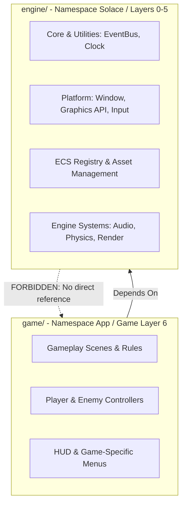

# Solace: Developer Guide & Coding Standards

Данный документ содержит исчерпывающее руководство для разработчиков кодовой базы **Solace**. Он регламентирует стандарты написания кода на C++20, правила управления памятью, межмодульную изоляцию, порядок сборки и процедуру подготовки релизных артефактов.

> \[!IMPORTANT\]
> Соблюдение требований настоящего руководства обязательно при внесении любых изменений в директории `engine/` и `game/`. Нарушение код-стайла или архитектурных границ (описанных в [`ENGINEERING_HANDBOOK.md`](./ENGINEERING_HANDBOOK.md)) является основанием для отклонения Pull Request.

## Навигация по руководству

1. [Философия и архитектурные границы](#1-философия-и-архитектурные-границы)
2. [Стандарты кодирования (C++20 Code Style)](#2-стандарты-кодирования-c20-code-style)
3. [Управление памятью и ресурсами](#3-управление-памятью-и-ресурсами)
4. [Обработка ошибок и логирование](#4-обработка-ошибок-и-логирование)
5. [Сборка проекта и пресеты CMake](#5-сборка-проекта-и-пресеты-cmake)
6. [Регламент подготовки релизов](#6-регламент-подготовки-релизов)
7. [Техническая справочная документация](#7-техническая-справочная-документация)

---

## 1. Философия и архитектурные границы

Разработка движка и игры ведётся с чётким разделением ответственности между универсальной платформой (`engine/`) и прикладной логикой (`game/`).



> \[!CAUTION\]
> **Категорически запрещено:**
>
> * Использовать типы или заголовочные файлы из `game/` внутри исходного кода `engine/`.
> * Размещать игровой баланс, конкретные механики игроков/врагов или сценарии внутри подсистем движка.
> * Нарушать инкапсуляцию слоёв (например, подключать заголовки OpenGL/SDL3 напрямую в высокий слой `game/`).

---

## 2. Стандарты кодирования (C++20 Code Style)

Мы используем современный стандарт **C++20**. Код должен быть выразительным, безопасным с точки зрения типов и оптимизированным для компилятора.

### 2.1 Именование сущностей (Naming Conventions)

| Сущность | Стиль именования | Пример | 
| ----- | ----- | ----- | 
| **Пространства имён** | `PascalCase` | `Solace::Core`, `App::Combat` | 
| **Классы и структуры** | `PascalCase` | `EntityRegistry`, `DamageSystem` | 
| **Методы и функции** | `snake_case` | `get_component()`, `process_destroy()` | 
| **Переменные и параметры** | `snake_case` | `delta_time`, `target_entity` | 
| **Приватные поля классов** | `m_snake_case` | `m_event_bus`, `m_is_active` | 
| **Константы и `constexpr`** | `UPPER_SNAKE_CASE` | `MAX_ENTITIES`, `DEFAULT_TIMEOUT_MS` | 
| **Enum class элементы** | `PascalCase` | `DamageType::Physical`, `State::Idle` | 
| **Имена файлов** | `snake_case.hpp` / `.cpp` | `event_bus.hpp`, `damage_system.cpp` | 

### 2.2 Структура заголовочных файлов

* Каждый заголовочный файл **обязан** начинаться с директивы `#pragma once`.
* Следует минимизировать включения сторонних тяжеловесных заголовков (`<SDL3/SDL.h>`, `<glad/glad.h>`, `<ozz/...>`) внутри `include/`. Используйте **Forward Declarations** там, где это возможно.
* Реализуйте строгий порядок импортов:

```cpp
#pragma once

// 1. Стандартная библиотека C++
#include <cstdint>
#include <memory>
#include <vector>

// 2. Заголовки низших слоёв движка (Solace)
#include "engine/core/event_bus.hpp"

// 3. Заголовки текущего слоя/модуля
#include "game/components/health.hpp"
```

> \[!NOTE\]
> Все заголовки графических API и системных библиотек подключаются исключительно в `.cpp` файлах соответствующих платформ (Layer 0 / Layer 2).

---

## 3. Управление памятью и ресурсами

Проект придерживается принципа **RAII** (Resource Acquisition Is Initialization) и строгого разграничения владения объектами.

### 3.1 Правила владения и указателей

* **`std::unique_ptr`** — используется для монопольного владения (например, создаваемые системы внутри сцен, ресурсы подсистем).
* **`std::shared_ptr`** — используется для разделяемых иммутабельных ресурсов (например, меши, текстуры, аудио-клипы в `AssetCache`).
* **Сырые указатели (`T*`)** — допускаются **только** для невладеющих ссылок без передачи прав управления памятью (например, опциональный доступ к объекту).
* **Использование `new` / `delete` запрещено** (Code Review Reject). Исключение: обертки низкоуровневых си-подобных библиотек (OpenGL, SDL3), сразу помещаемые в RAII-контейнеры.

### 3.2 Компоненты ECS (Data Layout)

Компоненты должны оставаться чистыми структурами данных (POD / Standard Layout):

```cpp
// Корректный компонент
struct TransformComponent {
    glm::vec3 position{0.0f};
    glm::quat rotation{1.0f, 0.0f, 0.0f, 0.0f};
    glm::vec3 scale{1.0f};
};

// Запрещено: хранить логику, функции и ссылки на системы в компоненте
struct InvalidComponent {
    std::function<void()> on_update; // Ошибка: логика принадлежит системам
    class DamageSystem* system_ref;  // Ошибка: сырая ссылка на систему
};
```

---

## 4. Обработка ошибок и логирование

Для диагностики и отладки используется подсистема `Logger` с четырьмя уровнями приоритета.

```cpp
// Примеры правильного вызова логгера
Logger::debug("AnimationController: blended state crossfade t={:.2f}", time);
Logger::info("AssetCache: loaded model asset '{}'", path_str);
Logger::warn("ConfigCache: parameter 'speed' not found, using default value");
Logger::error("Shader: failed to compile vertex shader stage");
```

> \[!WARNING\]
> **Запрещено:**
>
> 1. Вызывать `Logger::info` или `Logger::error` внутри обновляемых методов рантайма (`update`, `render`, `hot-path`) без флага отладки. Логирование в кадре приводит к просадкам производительности.
> 2. Использовать `assert()` в релизных сборках. В случае сбоев инициализации логируйте ошибку и выбрасывайте исключение `std::runtime_error`.

---

## 5. Сборка проекта и пресеты CMake

Сборка осуществляется кроссплатформенно через **CMake 3.25+** и файл манифеста `CMakePresets.json`.

### Сборка под Windows (Visual Studio 2022 / MSVC)

```bash
# Конфигурация в Debug режиме
cmake --preset windows-vs-debug

# Компиляция бинарных файлов
cmake --build --preset windows-vs-debug --parallel
```

### Сборка под Linux (GCC / Clang / Ninja)

```bash
# Конфигурация
cmake --preset linux-debug

# Сборка проекта
cmake --build --preset linux-debug --parallel
```

### Сборка в Release режиме

```bash
cmake --preset windows-vs-release
cmake --build --preset windows-vs-release
```

Исполняемые файлы компилируются в директории `out/build/<preset-name>/bin/`. Запуск должен производиться из корневого каталога репозитория.

---

## 6. Регламент подготовки релизов

Процесс подготовки релиза включает автоматизированную сборку, присвоение тега и упаковку артефактов согласно стандартам в [`GIT_GUIDE.md`](./GIT_GUIDE.md).

### 6.1 Чек-лист проверки перед релизом

* \[ \] Ветка `dev` полностью протестирована и слита в `main` через Pull Request.
* \[ \] Все автоматические проверки CI (`build-linux`, `build-windows`, `clang-format`) прошли успешно.
* \[ \] Файл `CHANGELOG.md` содержит обновлённую информацию в секции версии (раздел `[Unreleased]` перенесён в соответствующий релизный тег).
* \[ \] Сборка в режиме `Release` собирается без предупреждений компилятора (`-Werror`).

### 6.2 Публикация релиза на GitHub

1. Присвойте подписанный тег версии в ветке `main`:

   ```bash
   git checkout main
   git pull origin main
   git tag -a v0.1-foundation -m "Solace Release v0.1-foundation"
   git push origin v0.1-foundation
   ```

2. Заархивируйте собранный дистрибутив (включая `.exe`, необходимые `.dll` и папку `assets/`) в архив вида `Solace_v0.1-foundation_win64.zip`.
3. Перейдите в раздел **Releases -> Draft a new release** на GitHub.
4. Выберите созданный тег, скопируйте соответствующий блок изменений из `CHANGELOG.md` и прикрепите архив дистрибутива в блок **Attach binaries**.

---

## 7. Технические справочные ресурсы

Для работы над проектом рекомендуются следующие официальные материалы:

* [Документация по стандарту C++20 (cppreference)](https://en.cppreference.com/w/cpp/20)
* [Спецификация OpenGL 4.3 Core Profile](https://registry.khronos.org/OpenGL/specs/gl/glspec43.core.pdf)
* [Официальная документация SDL3 Wiki](https://wiki.libsdl.org/SDL3)
* [Документация библиотеки ozz-animation](https://guillaumeblanc.github.io/ozz-animation/)
* [LearnOpenGL — Руководство по графическому рендерингу](https://learnopengl.com/)