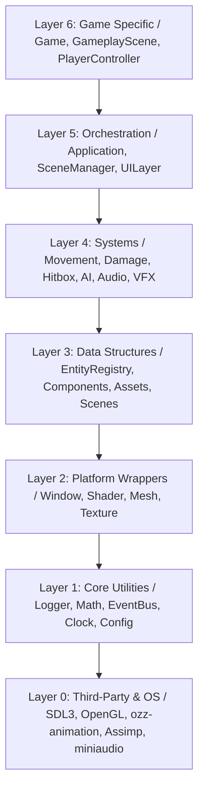
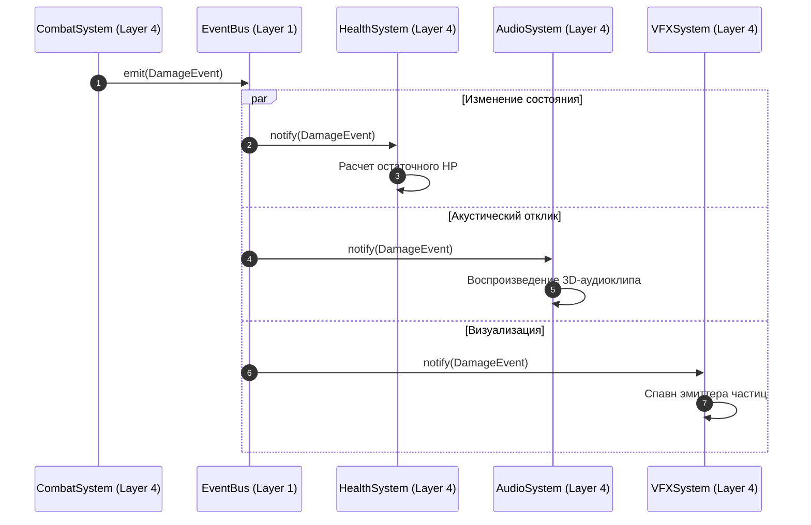

# Solace: Engineering Handbook

> \[!IMPORTANT\]
> **Hard Rule:** Настоящий документ содержит обязательные архитектурные регламенты и технические спецификации разработки кодовой базы движка и игры **Solace** (C++20 / OpenGL 4.3 Core). Соблюдение описанных стандартов контролируется на этапе Code Review. Нарушение ключевых правил является основанием для автоматического отклонения Pull Request.

## Навигация по документу

 1. [Философия и целеполагание проекта](#1-философия-и-целеполагание-проекта)

 2. [Архитектурные регламенты (Hard Rules)](#2-архитектурные-регламенты-hard-rules)

 3. [Структура репозитория и модулей](#3-структура-репозитория-и-модулей)

 4. [Стандарты написания и оформления кода](#4-стандарты-написания-и-оформления-кода)

 5. [Регламент процессов разработки и контроля качества](#5-регламент-процессов-разработки-и-контроля-качества)

 6. [Техническая дорожная карта и критерии приемки](#6-техническая-дорожная-карта-и-критерии-приемки)

 7. [Реестр архитектурных антипаттернов](#7-реестр-архитектурных-антипаттернов)

 8. [Критерии готовности систем (Definition of Done)](#8-критерии-готовности-систем-definition-of-done)

 9. [Регламент интеграции новой функциональности](#9-регламент-интеграции-новой-функциональности)

10. [Протокол диагностики и локализации неисправностей](#10-протокол-диагностики-и-локализации-неисправностей)

## 1. Философия и целеполагание проекта

### 1.1 Назначение системы

Проект **Solace** представляет собой кроссплатформенный 2.5D/3D Action-RPG движок и прикладную игру, разрабатываемую на языке C++20 с использованием графического API OpenGL 4.3 Core Profile. Ключевая цель — построение высокопроизводительной, отчуждаемой и масштабируемой архитектурной платформы с низким уровнем задержки ввода и детерминированной обработкой геймплейных событий.

### 1.2 Приоритеты проектирования

Принятие инженерных решений осуществляется на основе следующей строгой иерархии приоритетов:

1. **Детерминированность и корректность функционирования** — гарантированное соответствие сборки спецификациям, отсутствие ошибок выполнения и утечек ресурсов.

2. **Прозрачность и читаемость архитектуры** — строгая локализация ответственности компонентов, обеспечивающая ускоренный аудит и ввод новых участников.

3. **Архитектурная выразительность** — следование принципам SOLID, стандартам RAII и паттернам проектирования без переусложнения кодовой базы.

> \[!NOTE\]
> Архитектурная элегантность не должна препятствовать стабильности работы. Если паттерн проектирования требует существенного усложнения структуры без выраженного выигрыша в производительности или поддерживаемости, предпочтение отдается более прямому и прозрачному решению.

### 1.3 Ограничения области разработки (Out of Scope)

Для сохранения фокуса разработки в текущей итерации из области проекта **исключены** следующие компоненты:

* Универсальные ECS-фреймворки сторонних разработчиков (используется собственная специализированная подсистема на базе Dense Array).

* Встроенные сторонние физические движки общего назначения (используется собственный резолвер коллизий типа `Capsule Sweep`).

* Сетевой стек и архитектура синхронизации состояния.

* Визуальный редактор уровней общего назначения (заменен типизированной конфигурацией JSON и процедурной генерацией).

* Скриптовые языки высокого уровня (вся бизнес-логика реализуется на C++20).

## 2. Архитектурные регламенты (Hard Rules)

### 2.1 Иерархия слоев и порядок зависимостей (Layering Standard)

Система разделена на 7 независимых уровней (от 0 до 6). Модуль слоя $N$ имеет право включать заголовочные файлы только нижележащих слоев $0 \dots N-1$. Прямые или косвенные цикличные зависимости между слоями, а также обращения «снизу вверх» строго запрещены.



| Слой | Наименование | Содержание и назначение | Разрешенные зависимости | 
| ----- | ----- | ----- | ----- | 
| **0** | **Platform Third-Party** | Низкоуровневые системные библиотеки (SDL3, OpenGL 4.3, ozz-animation, Assimp, miniaudio). | Отсутствуют | 
| **1** | **Core Utilities** | Базовые утилиты: `Logger`, `Math`, `EventBus`, `Clock`, `ConfigCache`. | Layer 0 | 
| **2** | **Platform Wrappers** | RAII-обертки ресурсов платформы: `Window`, `Shader`, `Mesh`, `Texture`. | Layers 0–1 | 
| **3** | **Data Structures** | Структуры данных и ECS: `EntityRegistry`, `ComponentPools`, `AssetCache`. | Layers 0–2 | 
| **4** | **Systems** | Изолированные системы обработки данных: `Movement`, `Damage`, `Hitbox`, `AI`, `Audio`, `VFX`. | Layers 0–3 | 
| **5** | **Orchestration** | Оркестрация приложения и сцен: `Application`, `SceneManager`, `UILayer`. | Layers 0–4 | 
| **6** | **Game-Specific** | Прикладная логика конкретной игры: `Game`, `GameplayScene`, `PlayerController`. | Layers 0–5 | 

**Классификация нарушений:**

* Компонент `RenderComponent` (Layer 3) хранит тип `GLuint` напрямую — нарушение границы Layer 0.

* Система `DamageSystem` (Layer 4) напрямую вызывает метод `AudioSystem::play()` — кросс-зависимость внутри одного слоя.

* Класс `Application` (Layer 5) содержит жесткую ссылку на `EnemyClass` — нарушение границы Layer 6.

> \[!IMPORTANT\]
> Соблюдение слоев изолируется на уровне целей CMake. Каждая подбиблиотека собирается независимо с явно указанными `PUBLIC`/`PRIVATE` зависимостями.

### 2.2 Внедрение зависимостей (Dependency Injection)

В кодовой базе **запрещено использование паттерна Singleton**, а также глобальных или статических переменных, хранящих состояние.

* Экземпляры сервисов (`EventBus`, `EntityRegistry`, `AssetCache`, `Clock`) создаются на уровне слоя оркестрации (`Application` / `SceneManager`) и явно передаются нижележащим компонентам через конструкторы или параметры методов.

* Передача зависимостей обеспечивает полную изолированность систем при модульном тестировании, а также позволяет параллельно исполнять независимые сцены (например, фоновую загрузку и геймплей).

### 2.3 Декупликация систем через шину событий (EventBus)

Системы слоя 4 не обладают знаниями о существовании друг друга. Межсистемное взаимодействие реализуется исключительно посредством отправки и обработки сообщений через централизованную шину событий `EventBus`.



**Регламент выбора типа вызова:**

* **Событие (Decoupled):** Используется для оповещения произвольного числа систем о произошедшем факте (например, `DamageEvent`, `SpawnParticleEvent`, `DeathEvent`).

* **Прямой вызов (Tight):** Допускается только внутри одной системы или при обращении системы к чисто функциональным утилитам нижележащих слоев (например, `CollisionWorld::moveCapsule()`, `Shader::setMat4()`).

### 2.4 Типизированное управление конфигурациями (Typed ConfigCache)

* **Запрещено:** Выполнять текстовый поиск (`string lookup`) или парсинг документов JSON в основном цикле выполнения (`update`/`render`).

* **Обязательно:** При инициализации приложения данные JSON-конфигураций десериализуются в POD-структуры памяти (`PlayerConfig`, `EnemyConfig`).

* Доступ систем к параметрам осуществляется через прямое чтение полей типизированных структур (`config.player.movement.speed`).

* Горячая перезагрузка конфигураций (Hot-Reload по клавише `F5`) атомарно обновляет структуры в памяти без приостановки приложения.

### 2.5 Семантика компонентов данных (POD-Components)

Компоненты сущностей хранят только данные.

* **Запрещено:** Размещать внутри компонентов виртуальные методы, логику обработки, `std::function` или сырые указатели на системы.

* **Разрешено:** Использование базовых типов, glm-структур, перечислений `enum class`, `EntityID` и `std::shared_ptr` для дескрипторов ресурсов.

### 2.6 Разделяемое владение ресурсами (Shared Asset Ownership)

Для предотвращения избыточных дубликатов в памяти VRAM/RAM задействуется двухуровневая модель:

1. **Тяжелые ресурсы (`ModelAsset`, `TextureAsset`):** Неизменяемы (immutable), хранятся в `AssetCache` в единственном экземпляре и распространяются через `std::shared_ptr`.

2. **Контекст экземпляра (`AnimationComponent`, `RenderComponent`):** Хранит уникальное для каждой сущности состояние (текущее время анимации, матрицы трансформации костей, экземпляры SSBO).

### 2.7 Отложенная мутация состояния ECS (Deferred Mutation)

Удаление сущностей или отвязка компонентов не выполняется немедленно в момент вызова внутри систем.

* Вызов `registry.destroy(entity_id)` помечает сущность флагом и помещает ее в очередь `m_pendingDestroy`.

* Фактическое высвобождение памяти и перестройка массивов Dense Array происходит централизованно в конце кадра на уровне слоя оркестрации (`registry.processDestroy()`).

* Данный подход исключает возникновение ошибок обращения к освобожденной памяти (Use-After-Free) при итерации других систем по тому же кадру.

### 2.8 Изоляция масштабов времени (Per-System Time Separation)

Система поддерживает три независимых контекста времени:

1. **Real Time (`realDt`):** Не зависит от паузы и замедления. Используется подсистемами ввода, пользовательского интерфейса, ImGui и логирования.

2. **Gameplay Time (`gameplayDt`):** Зависит от состояния паузы и коэффициентов замедления. Используется системами физики, движения, анимации и ИИ.

3. **Slow-Mo / HitStop Time:** Механизм временной заморозки кадра, при котором `gameplayDt` принудительно обнуляется на $N$ кадров при сохранении обновления `realDt`.

### 2.9 Явное управление ресурсами (RAII Standard)

Использование сырых указателей с операторами `new`/`delete` запрещено. Детальные правила управления памятью приведены в [`DEVELOPER_GUIDE.md`](./DEVELOPER_GUIDE.md#3-управление-памятью-и-ресурсами). Управление жизненным циклом ресурсов осуществляется с применением смарт-указателей и RAII-оберток:

* `std::unique_ptr` — для объектов с монопольным владением (системы, сцены).

* `std::shared_ptr` — для ресурсов с разделяемым чтением (ассеты).

* RAII-классы (`Shader`, `Buffer`, `Texture`) — для ресурсов графического API OpenGL.

### 2.10 Обязательная отладочная визуализация (Debug-First Standard)

Любая разрабатываемая система слоя 4 обязана предоставлять визуальное представление своего внутреннего состояния в отладочном оверлее (`ImGui` / Gizmos, вызываемом по клавише `F1`):

* **Physics/Collision:** Рендеринг капсул коллизий, вектора движения и ограничивающих объемов AABB.

* **Combat/Hitbox:** Визуализация зон поражения с цветовой индикацией активных фаз атаки.

* **AI:** Отображение графа состояний, векторов намерений и радиусов обнаружения.

* **ECS/EventBus:** Инспекция сущностей, компонентов и хронологический лог последних событий.

## 3. Структура репозитория и модулей

### 3.1 Иерархия каталогов

```text
solace/
├── engine/                         # Ядро движка (Layers 0–5)
│   ├── include/engine/
│   │   ├── core/                   # Layer 1: EventBus, Clock, ConfigCache, Logger, Math
│   │   ├── platform/               # Layer 2: Window, Shader, Mesh, Texture
│   │   ├── assets/                 # Layer 3: ModelCache, TextureCache, AudioCache
│   │   ├── ecs/                    # Layer 3: EntityRegistry, ComponentPools
│   │   ├── scene/                  # Layers 3–5: Scene, SceneManager
│   │   ├── animation/              # Layer 4: AnimationStateMachine, Skinning
│   │   ├── physics/                # Layer 4: CollisionWorld, CapsuleSweep
│   │   ├── graphics/               # Layer 4: Renderer, Particles, PostProcess
│   │   ├── audio/                  # Layer 4: AudioEngine, SoundPool
│   │   ├── ui/                     # Layer 5: HUD, DebugOverlay
│   │   └── application.hpp         # Layer 5: Application Entrypoint
│   └── src/                        # Исходный код (.cpp), зеркальный структуре include/
│
├── game/                           # Прикладная игра (Layer 6)
│   ├── include/game/
│   │   ├── components/             # Layer 3: Transform, Health, Movement, Combat
│   │   ├── systems/                # Layer 4: MovementSystem, DamageSystem, AISystem
│   │   ├── scenes/                 # Layer 5: GameplayScene, MenuScene
│   │   ├── events/                 # Layer 3: DamageEvent, PlayerDeathEvent
│   │   ├── configs/                # Типы данных для ConfigCache
│   │   └── core/game.hpp           # Layer 6: Главный класс игры
│   └── src/                        # Исходный код (.cpp) прикладного слоя
│
├── assets/                         # Игровые ресурсы
│   ├── configs/                    # Файлы конфигурации JSON
│   ├── models/                     # 3D-модели и меши (.glb)
│   ├── animations/                 # Клипы скелетной анимации (.ozz)
│   ├── audio/                      # Звуковые файлы (.wav, .ogg)
│   └── shaders/                    # Исходный код шейдеров (.glsl)
│
└── docs/                           # Техническая документация
```

### 3.2 Распределение модулей по CMake-целям

```cmake
add_library(engine_core     STATIC ...) # Layer 1
add_library(engine_platform STATIC ...) # Layer 2
add_library(engine_data     STATIC ...) # Layer 3
add_library(engine_systems  STATIC ...) # Layer 4
add_library(engine_ui       STATIC ...) # Layer 5

target_link_libraries(engine_core     PRIVATE SDL3::SDL3 glad::glad miniaudio)
target_link_libraries(engine_platform PUBLIC engine_core)
target_link_libraries(engine_data     PUBLIC engine_platform)
target_link_libraries(engine_systems  PUBLIC engine_data)
target_link_libraries(engine_ui       PUBLIC engine_systems)
```

## 4. Стандарты написания и оформления кода

Подробное руководство по стандартам оформления кода и правилам именования сущностей приведено в [`DEVELOPER_GUIDE.md`](./DEVELOPER_GUIDE.md#2-стандарты-кодирования-c20-code-style).

### 4.1 Соглашение об именовании (Naming Rules)

| Элемент кода | Стиль именования | Пример | 
| ----- | ----- | ----- | 
| **Классы и структуры** | `PascalCase` | `EntityRegistry`, `DamageSystem` | 
| **Функции и методы** | `snake_case` | `get_component()`, `process_destroy()` | 
| **Приватные поля классов** | `m_snake_case` | `m_event_bus`, `m_is_initialized` | 
| **Константы и `constexpr`** | `UPPER_SNAKE_CASE` | `MAX_ENTITIES`, `DEFAULT_FOV` | 
| **Enum class** | `PascalCase` | `DamageType::Fire`, `State::Running` | 
| **Имена файлов** | `snake_case.hpp` / `.cpp` | `event_bus.hpp`, `damage_system.cpp` | 

### 4.2 Требования к заголовочным файлам

* Использование директивы `#pragma once` во всех заголовочных файлах.

* Обязательное использование опережающих объявлений (Forward Declarations) для уменьшения времени компиляции.

* Включение сторонних заголовков (`<SDL3/SDL.h>`, `<glad/glad.h>`) допускается только внутри `.cpp`-файлов слоя реализации.

### 4.3 Уровни логирования и обработка ошибок

Логирование выполняется через класс `Logger` с явным указанием категории:

* `Logger::error()` — Критические сбои, приводящие к невозможности продолжения выполнения операции (выбрасывает исключение на этапе инициализации).

* `Logger::warn()` — Нештатные ситуации, обработанные системой с восстановлением значения по умолчанию (например, отсутствие поля в JSON).

* `Logger::info()` — Однократные информационные сообщения о смене состояний (запуск систем, загрузка сцен).

* `Logger::debug()` — Отладочная информация, активная исключительно в сборках Debug.

> \[!CAUTION\]
> Вызов `Logger::info()` внутри методов циклического обновления (`update`/`render`) строго запрещен во избежание деградации производительности.

## 5. Регламент процессов разработки и контроля качества

Процесс создания и проверки Pull Request регламентируется согласно [`GIT_GUIDE.md`](./GIT_GUIDE.md#3-правила-создания-pull-request-pr).

### 5.1 Правила работы с системами контроля версий (Git Flow)

* Разработка ведется в изолированных ветках: `feature/<name>`, `fix/<name>`, `refactor/<name>`.

* Прямой push в ветки `main` и `dev` заблокирован настройками репозитория.

* Форматирование сообщений коммитов строго соответствует спецификации **Conventional Commits** (см. [`GIT_GUIDE.md`](./GIT_GUIDE.md#2-стандарты-коммитов-conventional-commits)):
  `feat(animation): add crossfade blending support`

### 5.2 Критерии проведения Code Review

Перед слиянием Pull Request проверяются следующие пункты:

1. Полное отсутствие предупреждений компилятора (`-Wall -Wextra -Werror` / `/W4 /WX`).

2. Соблюдение правил направленности зависимостей слоев.

3. Отсутствие статических состояний и синглтонов.

4. Отсутствие выделения памяти через оператор `new` в бизнес-логике.

5. Наличие отладочной визуализации в оверлее `ImGui`.

## 6. Техническая дорожная карта и критерии приемки

### Фаза 0: Базовый фундамент архитектуры (Phase 0 — Foundation)

```mermaid
gantt
    title Зависимости задач Фазы 0
    dateFormat X
    axisFormat %s
    
    section Core
    0.1 EventBus (Type-Erased)       :active, p0_1, 0, 1d
    0.2 Clock Separation             :p0_2, after p0_1, 1d
    0.4 ConfigCache (Typed Hot-Reload):p0_4, after p0_1, 1d
    
    section ECS & Scenes
    0.3 EntityRegistry (Deferred)    :p0_3, after p0_1, 2d
    0.5 Scene Lifecycle              :p0_5, after p0_3, 1d
    0.7 Component Definitions        :p0_7, after p0_3, 1d
    
    section Tools
    0.6 Debug Overlay (ImGui)        :p0_6, after p0_5, 1d
```



#### Спецификация задач Фазы 0:

* **0.1 EventBus:**

  * Реализация шины событий без применения статического состояния.

  * *Критерии приемки:* Поддержка подписки, мгновенной отправки (`emit`) и отложенной очереди (`queue`). Прохождение модульных тестов.

* **0.2 Clock Separation:**

  * Изоляция системного времени от игрового.

  * *Критерии приемки:* При установке `gameplayDt = 0` (HitStop / Пауза) подсистема интерфейса и ImGui продолжает обновляться с частотой `realDt`.

* **0.3 EntityRegistry:**

  * Реализация хранилища сущностей на базе плоских массивов (Dense Array).

  * *Критерии приемки:* Итерация по 1000 сущностей не вызывает просадок кадра; отложенное удаление (`Deferred Destroy`) полностью устраняет ошибки Use-After-Free.

* **0.4 ConfigCache:**

  * Создание типизированного кэша конфигураций.

  * *Критерии приемки:* Нажатие клавиши `F5` перечитывает конфигурации JSON и атомарно обновляет значения полей структур без перезапуска приложения.

* **0.5 Scene Lifecycle:**

  * Управление состоянием сцен (`onEnter`, `onUpdate`, `onExit`, `clear`).

  * *Критерии приемки:* Переключение между игровыми сценами не приводит к утечкам памяти (подтверждено AddressSanitizer).

* **0.6 Debug Overlay:**

  * Интеграция отладочного оверлея ImGui по клавише `F1`.

  * *Критерии приемки:* Доступен инспектор сущностей ECS, лог событий EventBus в реальном времени и графики времени кадра.

* **0.7 Component Definitions:**

  * Базовый набор POD-компонентов.

  * *Критерии приемки:* Все заголовки компонентов содержат только данные без методов и логики.

### Фаза 1: Боевой вертикальный срез (Phase 1 — Combat Vertical Slice)

* **1.1 AnimationStateMachine:** Многослойное смешивание скелетных анимаций и кроссфейды.

* **1.2 AnimationEvents:** Генерирование событий `EventBus` по ключевым кадрам анимации (триггеры атак, звуков).

* **1.3 Capsule Collision:** Пространственная физика движения с обработкой скольжения вдоль стен.

* **1.4 DamageSystem:** Единый центр расчета урона, периода неуязвимости (i-frames) и состояния смерти.

* **1.5 Bone-Attached Hitboxes:** Связывание геометрии хитбоксов с трансформацией костей скелета.

* **1.6 HitStop & Camera Shake:** Эффекты остановки времени и процедурной тряски камеры на базе шума Перлина.

* **1.7 Positional Audio:** Позиционируемый 3D-звук с затуханием по расстоянию.

* **1.8 ParticleSystem:** Инстансированный рендеринг частиц с использованием SSBO.

* **1.9 HUD:** Отображение полос состояния, выносливости и всплывающих чисел урона.

* **1.10 Playtest:** Проведение интеграционного тестирования сборок.

## 7. Реестр архитектурных антипаттернов

Ниже приведен список категорически запрещенных решений и их корректных альтернатив:

| Антипаттерн | Причина запрета | Корректное решение | 
| ----- | ----- | ----- | 
| `static EventBus::getInstance()` | Ломает изолированность, делает невозможным параллельное тестирование. | Явная передача объекта через конструктор (DI). | 
| `std::unique_ptr<Model>` в компоненте | Приводит к $N$-кратному дублированию тяжелых данных в памяти VRAM. | `std::shared_ptr<ModelAsset>` с хранением в `AssetCache`. | 
| Вызов `AudioSystem::play()` из `DamageSystem` | Создает жесткую связность между системами одного слоя. | Отправка `PlaySoundEvent` через шину `EventBus`. | 
| Прямые вызовы OpenGL в `RenderComponent` | Нарушает иерархию слоев (Layer 3 знает о Layer 0). | Вынос логики рендеринга в `RenderSystem` (Layer 4). | 
| `registry.destroy()` с немедленным удалением | Вызывает ошибки Use-After-Free в текущем кадре у других систем. | Отложенная очередь удаления `registry.processDestroy()`. | 
| Чтение JSON по ключу в `System::update` | Хэширование строк и парсинг парсинга фатально снижают FPS. | Предварительный парсинг в типизированный `ConfigCache`. | 
| `timeScale = 0.001` для реализации HitStop | Ломает точность физического расчета и задерживает обновление UI. | Обнуление `gameplayDt = 0` при сохранении `realDt`. | 

## 8. Критерии готовности систем (Definition of Done)

Система считается завершенной и готовой к слиянию в ветку `dev` при выполнении следующих условий:

1. **Функциональность:** Полное соответствие критериям приемки ТЗ, отсутствие регресса существующего кода.

2. **Производительность:** Время выполнения системы в кадре не превышает выделенный бюджет (отсутствие просадок FPS).

3. **Архитектурная чистота:** Отсутствие нарушений правил слоев, отсутствуют статические состояния, компоненты являются POD-структурами.

4. **Управление памятью:** Отсутствие утечек памяти и ресурсов, подтвержденное прогоном под `AddressSanitizer` и `LeakSanitizer`.

5. **Отладка:** В `DebugOverlay` добавлена интерактивная визуализация состояния системы.

6. **Документация:** Обновлены файлы `CHANGELOG.md` и соответствующие JSON-конфигурации.

## 9. Регламент интеграции новой функциональности

Разработка нового модуля производится по строгому алгоритму:

1. Формулирование критериев приемки (3–5 четких условий готовности).

2. Определение контрактов данных (POD-компоненты и структуры событий).

3. Создание минимальной реализации системы (Happy Path).

4. Проверка работы функциональности на тестовой сцене.

5. Интеграция визуализации в `DebugOverlay` (`F1`).

6. Обработка граничных условий (Edge Cases) и ошибок.

7. Профилирование и оптимизация при необходимости.

8. Прохождение чек-листа Code Review и слияние PR.

## 10. Протокол диагностики и локализации неисправностей

При возникновении сбоев или аномалий в работе приложения применяется следующий порядок действий:

### 10.1 Диагностика ошибок выполнения

1. Анализ лог-файла: проверка последних вызовов `Logger::error()` и `Logger::warn()`.

2. Инспекция состояния через `DebugOverlay` (`F1`): проверка состава компонентов сущности и лога `EventBus`.

3. Проверка корректности конфигураций: выполнение горячей перезагрузки (`F5`) для исключения ошибок парсинга JSON.

4. Изоляция проблемы: отключение смежных систем в оверлее для поиска источника сбоя.

### 10.2 Поиск утечек памяти

1. Сборка проекта с флагами санитайзера: `-fsanitize=address,undefined`.

2. Проверка корректности вызова `registry.processDestroy()` в конце кадра.

3. Проверка цикличных ссылок при использовании `std::shared_ptr`.

### 10.3 Профилирование производительности

1. Активация графика времени кадра в `DebugOverlay`.

2. Поочередное отключение систем для локализации узкого места.

3. Подключение внешнего профилировщика (Tracy Profiler / RenderDoc) для детального анализа CPU/GPU выборок.