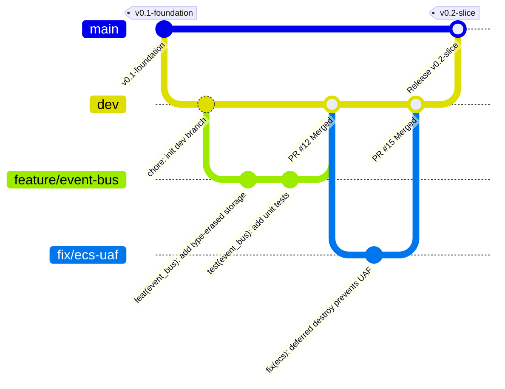

# Solace: GitHub Repository & Git Workflow Guide

[](https://www.conventionalcommits.org/)
[](https://git-lfs.github.com/)
[](https://github.com/diedeent/solace/actions)

Данный документ описывает правила работы с Git, стандарты коммитов, регламент создания Pull Request, настройки защиты веток, конфигурацию CI/CD и правила управления ассетами для проекта **Solace** (C++20 / OpenGL 4.3 Action-RPG).

Соблюдение этого руководства обязательно для всех участников команды.

---

## Навигация по документу

1. [Структура веток и Git Flow](#1-структура-веток-и-git-flow)
2. [Стандарты коммитов (Conventional Commits)](#2-стандарты-коммитов-conventional-commits)
3. [Правила создания Pull Request (PR)](#3-правила-создания-pull-request-pr)
4. [Защита веток (Branch Protection Rules)](#4-защита-веток-branch-protection-rules)
5. [Настройка CI/CD (GitHub Actions)](#5-настройка-cicd-github-actions)
6. [Управление ассетами и Git LFS](#6-управление-ассетами-и-git-lfs)
7. [Тегирование, релизы и CHANGELOG](#7-тегирование-релизы-и-changelog)

---

## 1. Структура веток и Git Flow

В проекте используется адаптированная схема **Git Flow**, оптимизированная для инди-разработки.

> [!IMPORTANT]
> **Прямые коммиты в ветки `main` и `dev` строго запрещены**. Изменения могут попадать в основные ветки только через Pull Request с обязательным прохождением автоматических проверок (CI) и одобрением от хотя бы одного ревьюера.

### 1.1 Основные ветки

* **`main`**
  * **Статус:** Защищённая ветка (Protected Branch).
  * **Назначение:** Хранит только стабильные, протестированные релизные версии кода (`v0.1-foundation`, `v0.2-slice` и т.д.).
* **`dev`**
  * **Статус:** Защищённая ветка интеграции.
  * **Назначение:** Основная рабочая ветка текущей итерации. Сюда сливаются выполненные задачи из рабочих веток.

### 1.2 Диаграмма жизненного цикла ветки (Git Workflow)



### 1.3 Префиксы рабочих веток

Все новые задачи выполняются в изолированных ветках, создаваемых от актуального состояния `dev`:

* `feature/<short-description>` — разработка новой функциональности (например, `feature/event-bus`, `feature/capsule-collision`).
* `fix/<short-description>` — исправление багов (например, `fix/ecs-deferred-destroy-uaf`).
* `refactor/<short-description>` — изменение кода без изменения функциональности (например, `refactor/animation-blending`).
* `docs/<short-description>` — обновление документации, хэндбука, README (например, `docs/update-handbook-v3`).
* `ci/<short-description>` — настройка CI/CD, CMake, сборочных скриптов.

---

## 2. Стандарты коммитов (Conventional Commits)

Мы используем стандарт **Conventional Commits v1.0.0**.

### 2.1 Формат сообщения коммита

```text
<type>(<scope>): <short description>

[optional body]

[optional footer(s)]
```

### 2.2 Допустимые типы (`type`) и компоненты (`scope`)

Типы коммитов обозначают характер изменений, а область (`scope`) указывает на затронутый подмодуль или слой кодовой базы.

#### Допустимые типы (`type`)
* `feat`: Добавление новой функциональности движка или игры.
* `fix`: Исправление ошибки/бага.
* `refactor`: Изменение кода, не меняющее логику работы и внешнее поведение.
* `perf`: Изменение кода, повышающее производительность (FPS, оптимизация памяти).
* `docs`: Изменения только в документации.
* `style`: Форматирование, пробелы, отсутствующие точки с запятой (без изменения кода).
* `test`: Добавление или исправление модульных тестов.
* `chore`: Обновление скриптов сборки, `.gitignore`, внешних зависимостей.

#### Допустимые области (`scope`)
Область задается гибко в зависимости от подсистемы:
* **Layer 1 (Core):** `core`, `event_bus`, `clock`, `config`, `logger`, `math`
* **Layer 2 (Platform):** `window`, `shader`, `mesh`, `texture`
* **Layer 3 (Data/ECS):** `ecs`, `assets`, `scene`
* **Layer 4 (Systems):** `animation`, `physics`, `graphics`, `audio`, `vfx`, `ai`
* **Layer 5 (Orchestration):** `app`, `ui`, `debug`
* **Layer 6 (Game):** `game`, `combat`, `player`, `enemy`
* **Tooling / Infra:** `cmake`, `deps`, `ci`

> [!TIP]
> Примеры корректных коммитов:
> * `feat(event_bus): add type-erased event handler storage`
> * `fix(ecs): defer entity destruction to prevent UAF in physics update`
> * `perf(graphics): optimize particle buffer updates via SSBO mapping`
> * `docs(handbook): update layering standards and DOD checklist`

---

## 3. Правила создания Pull Request (PR)

### 3.1 Требования к коду перед созданием PR

1. **Размер PR:** Изменения не должны превышать **400 строк кода**. Если PR > 600 строк — разбейте его на несколько последовательных задач.
2. **Отсутствие предупреждений компилятора:** Сборка должна проходить без warnings с флагами `-Wall -Wextra -Werror` (на MSVC: `/W4 /WX`).
3. **Debug Visualization:** Каждая новая система должна содержать визуализацию в отладочном оверлее (`ImGui` / Gizmos) согласно [Engineering Handbook](./ENGINEERING_HANDBOOK.md).

### 3.2 Чек-лист проверки при отправке PR

<details>
<summary><b>Шаблон оформления PR (.github/PULL_REQUEST_TEMPLATE.md)</b> [Нажмите для развертывания]</summary>

```markdown
## 📝 Описание изменений
<!-- Кратко опишите, какую задачу решает данный PR -->

## 🎯 Тип изменения
- [ ] `feat` — Новая функциональность
- [ ] `fix` — Исправление ошибки
- [ ] `refactor` — Рефакторинг кода
- [ ] `perf` — Оптимизация
- [ ] `docs` / `chore` — Документация / Настройка проекта

## 🏗️ Архитектурный слой (Layering Check)
- [ ] **Layering соблюдён:** Зависимости направлены только сверху вниз (Layer N -> Layer 0..N-1).
- [ ] **DI соблюдён:** Нет статиков с состоянием и синглтонов.
- [ ] **Components = POD:** Компоненты хранят только данные.

## 🧪 Как протестировать
1. Запустить приложение.
2. Вызвать тестируемое событие или открыть сцену.
3. Нажать `F1` для вызова Debug Overlay и проверить состояние систем.

## 📸 Скриншоты / Видео (для UI, VFX и графических систем)
<!-- Прикрепите скриншот отладочного оверлея или гифку -->

## ✅ Чек-лист перед отправкой
- [ ] Проект успешно собирается локально без предупреждений (`-Werror`).
- [ ] Код отформатирован согласно `.clang-format`.
- [ ] Отсутствуют вызовы `Logger::info` в рантайм-цикле (`update`/`render`).
- [ ] Добавлена отладочная визуализация (Debug Overlay).
```

</details>

---

## 4. Защита веток (Branch Protection Rules)

Для веток `main` и `dev` в панели управления GitHub (`Settings` -> `Branches`) выставляются следующие жёсткие правила:

> [!NOTE]
> * **Require a pull request before merging:** Обязательно минимум 1 одобрение (Approval) от участника команды перед слиянием.
> * **Require status checks to pass before merging:** Обязательное прохождение пайплайнов GitHub Actions (`build-linux`, `build-windows`, `clang-format`).
> * **Require linear history:** Запрещены обычные merge-коммиты с веб-интерфейса, разрешены только **Squash and Merge** или **Rebase and Merge**.

---

## 5. Настройка CI/CD (GitHub Actions)

Автоматический пайплайны непрерывной интеграции описываются в файле `.github/workflows/ci.yml`:

<details>
<summary><b>Конфигурация .github/workflows/ci.yml</b> [Нажмите для развертывания]</summary>

```yaml
name: Solace Engine CI

on:
  push:
    branches: [ "main", "dev" ]
  pull_request:
    branches: [ "main", "dev" ]

jobs:
  lint-formatting:
    name: Code Formatting Check
    runs-on: ubuntu-latest
    steps:
      - name: Checkout repository
        uses: actions/checkout@v4

      - name: Run clang-format check
        uses: JeS24/clang-format-lint-action@v2.4
        with:
          source: 'engine game'
          clang-format-version: '17'

  build-linux:
    name: Linux GCC (C++20 Debug)
    runs-on: ubuntu-22.04
    steps:
      - name: Checkout repository
        uses: actions/checkout@v4
        with:
          submodules: recursive

      - name: Install System Dependencies
        run: |
          sudo apt-get update
          sudo apt-get install -y cmake ninja-build libsdl3-dev libgl1-mesa-dev xorg-dev

      - name: Configure CMake
        run: |
          cmake -B build -G Ninja \
            -DCMAKE_BUILD_TYPE=Debug \
            -DCMAKE_CXX_FLAGS="-Wall -Wextra -Werror"

      - name: Build Engine & Game
        run: cmake --build build --config Debug

  build-windows:
    name: Windows MSVC (C++20 Debug)
    runs-on: windows-latest
    steps:
      - name: Checkout repository
        uses: actions/checkout@v4
        with:
          submodules: recursive

      - name: Configure CMake
        run: |
          cmake -B build \
            -DCMAKE_BUILD_TYPE=Debug

      - name: Build Engine & Game
        run: cmake --build build --config Debug
```

</details>

---

## 6. Управление ассетами и Git LFS

Во избежание увеличения размера репозитория все бинарные ресурсы проекта (модели, анимации, аудио, текстуры) отслеживаются с помощью **Git LFS**.

### 6.1 Файл `.gitattributes`

Убедитесь, что в корне репозитория создан файл `.gitattributes`:

```gitattributes
# Binary game assets via Git LFS
*.glb filter=lfs diff=lfs merge=lfs -text
*.gltf filter=lfs diff=lfs merge=lfs -text
*.fbx filter=lfs diff=lfs merge=lfs -text
*.ozz filter=lfs diff=lfs merge=lfs -text
*.png filter=lfs diff=lfs merge=lfs -text
*.jpg filter=lfs diff=lfs merge=lfs -text
*.tga filter=lfs diff=lfs merge=lfs -text
*.wav filter=lfs diff=lfs merge=lfs -text
*.ogg filter=lfs diff=lfs merge=lfs -text
*.mp3 filter=lfs diff=lfs merge=lfs -text
*.ttf filter=lfs diff=lfs merge=lfs -text

# Line endings normalization for code
*.cpp text eol=lf
*.hpp text eol=lf
*.h text eol=lf
*.c text eol=lf
*.glsl text eol=lf
*.json text eol=lf
*.cmake text eol=lf
CMakeLists.txt text eol=lf
```

---

## 7. Тегирование, релизы и CHANGELOG

### 7.1 Релизные теги (Milestones)

Теги проставляются исключительно в ветке `main` при завершении фаз разработки:

```bash
git checkout main
git pull origin main
git tag -a v0.1-foundation -m "Release Phase 0: Engine Foundation Ready"
git push origin v0.1-foundation
```

### 7.2 Формат ведения `CHANGELOG.md`

Каждый Pull Request, изменяющий функциональность, обязан сопровождаться записью в секции `[Unreleased]` файла `CHANGELOG.md`:

```markdown
# Changelog

## [Unreleased]

### Added
- Реализована система фильтрации событий в `EventBus`.

### Fixed
- Исправлен Use-After-Free при отложенном уничтожении сущностей в `EntityRegistry`.
```